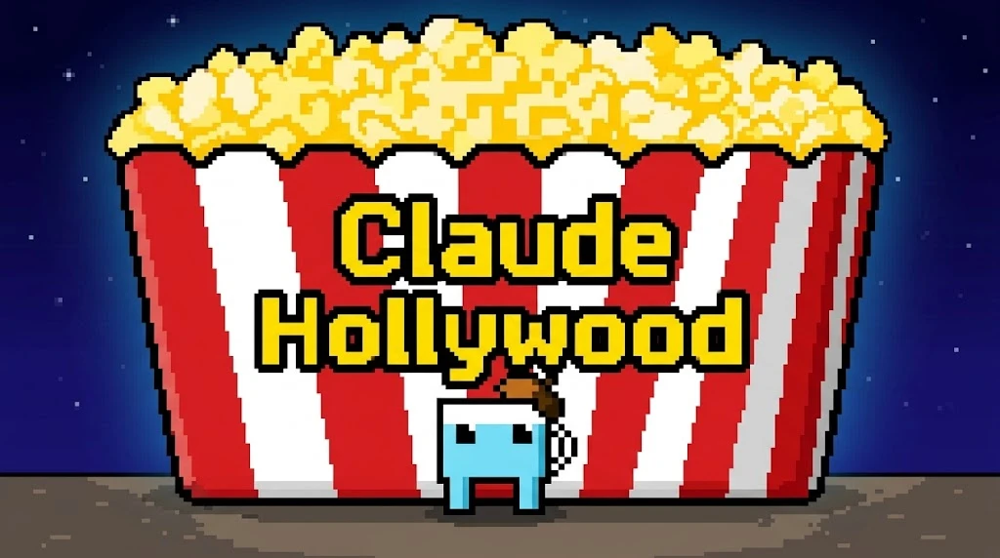
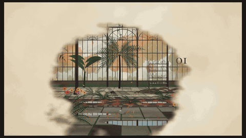
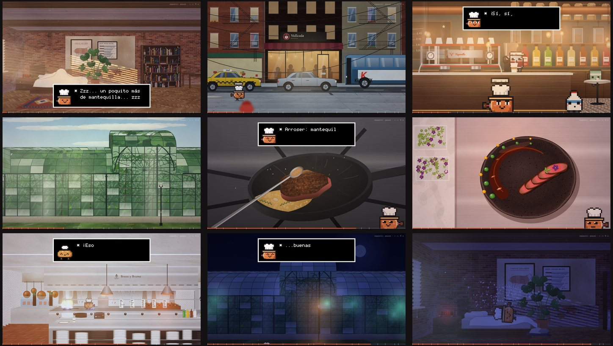
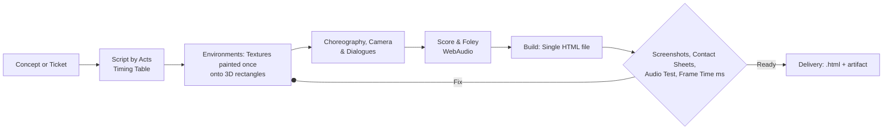

<p align="center">
  
</p>

<h3 align="center">Animated films made purely with code: art, music, and voices.</h3>

<p align="center">
  <a href="#install"></a>
  
  
  
  <a href="LICENSE"></a>
</p>

<p align="center">
  <a href="README.md">Español</a> | <b>English</b>
</p>

---

**Claude Hollywood** is a skill for Claude that turns an idea into an animated short film from 1 to 10 minutes long.

- **A single HTML file.** Opens directly in any browser and requires no server, external libraries, or external image assets.
- **Everything stems from code:**
  - Watercolor and 3D backgrounds;
  - Characters;
  - Sunlight beams filtering through window blinds;
  - Dust motes suspended in the air;
  - Simulating drape and falling fabric;
  - Music, footsteps, sound effects, and 8-bit voices.
- **Claude works just like a studio:** writes the script by acts, choreographs camera shots, and paints every texture piece by piece. It then composes the procedural soundtrack and audits its own work frame by frame before delivery.

## ▶ Watch it in action: *Claude Hollywood 101*

<p align="center">
  <a href="https://htmlpreview.github.io/?https://github.com/Anoth3rHellsing/Claude-Hollywood/blob/main/claude-hollywood-101.html">
    
  </a>
</p>

In this 3:26 short, **Aguada**, a little pixel-art cup with an artist's beret, explains how the skill works from inside the very world the skill drew:

1. Freezes the greenhouse to reveal its mathematical 3D skeleton.
2. Paints a watercolor wash layer by layer.
3. Throws a stone in slow motion.
4. Strikes the greenhouse glass panels like musical notes.

**[Watch Claude Hollywood 101](https://htmlpreview.github.io/?https://github.com/Anoth3rHellsing/Claude-Hollywood/blob/main/claude-hollywood-101.html)** (with audio, in Chrome or Edge). You can also download [`claude-hollywood-101.html`](claude-hollywood-101.html) and open it locally.

## Install

### In Claude Code

```text
/plugin marketplace add Anoth3rHellsing/Claude-Hollywood
/plugin install sumi-e-canvas-film@claude-hollywood
```

In a single line (Claude Code 2.1.275 or newer):

```text
/plugin install sumi-e-canvas-film --marketplace Anoth3rHellsing/Claude-Hollywood
```

From your terminal:

```bash
claude plugin marketplace add Anoth3rHellsing/Claude-Hollywood
claude plugin install sumi-e-canvas-film@claude-hollywood
```

### In claude.ai or Claude Desktop

1. Download **[`dist/sumi-e-canvas-film.zip`](dist/sumi-e-canvas-film.zip)**.
2. In Claude, go to **Customize → Skills**, click **+ → Create skill → Upload a skill**, and select the zip file.
3. Make sure **Code execution** and **File creation** are enabled in your settings.

## How to use

Ask for a movie just like you would commission an animation studio:

```text
/sumi-e-canvas-film:sumi-e-canvas-film assisted
I want a 4-minute short film: an old antique teapot gets lost in a Tokyo night market
and finds its way home by following the aroma of tea. Gentle, tender mood, rainy night, warm lanterns.
```

If you don't invoke it by its explicit name, natural language works too: *“Make me an animated watercolor intro for my channel…”*.

| Mode | How Claude works |
|---|---|
| `control` (default) | Asks a single round of 3–5 clarifying questions, fills in blanks, and shows you the decisions before building. |
| `auto` | Works autonomously from your initial concept and constraints. Proposes shots, scenes, and music entirely on its own. |
| `assisted` | Collaborates with you first on style, character design, and the beat-by-beat storyboard. Builds only when you say "go". |

Upon completion, it outputs the standalone `.html` file and, if you are in claude.ai, renders it as an interactive artifact ready to play and share.

## Capabilities

| | |
|---|---|
| 🖌️ **Watercolor & Sumi-e** | Ink bleeding, multi-layered washes, wet edges, breathable paper texture, calligraphic brushstrokes. |
| ✂️ **Cut-out paper art** | Layered shadows, laser-cut windows with backlighting, paper cityscapes shifting from day to night. |
| 🏠 **Detailed 3D scenes** (*Escenarios* engine) | Brickwork, herringbone wood flooring, brushed steel, and marble painted surface by surface. Real sunlight through window blinds, suspended dust motes, cloth simulation, reflective puddles, steam, day and night atmospheres. |
| 👾 **Pixel-art characters** | Geometric pixel shadows, reflections, dynamic lighting across sprites, procedurally generated background townsfolk. |
| 💬 **RPG-style dialogue** | Text boxes with portraits and **8-bit audio bleeps** whose cadence shifts with emotion (hurry, sleepy, exhausted), plus time-of-day badges. |
| 🎵 **Procedural sound** | Character themes, atmospheric beds, foley (wooden clogs, bells, flares) and LUFS-metered mixing. Zero audio samples or third-party AI voice vendors required. |
| 🎬 **Cinematic language** | Three-act scripts, push-ins, low angles, insert close-ups, slow motion, ink bleeding wipes, and pixel-dissolve transitions. |
| 🔍 **Automated QA** | Frame captures, contact sheets, automated audio event audits, and frame-time (ms) benchmarks before delivery. |

## Made with the skill

<p align="center">
  
</p>

| Film | Runtime | Highlights |
|---|---|---|
| **[Entre el Vapor y el Bit · Crónica de dos Estrellas](https://claude.ai/artifact/X2gP4MZQSCj5p5PDUGTahL)** ([html](entre-el-vapor-y-el-bit.html)) | 7:58 | A full day with Teo Cazorla, a copper saucepan who works as chef at a two-star restaurant: from rushing awake at dawn to midnight calm. Six 3D environments, seven characters, 8-bit dialogues. |
| **[Claude Hollywood 101](https://htmlpreview.github.io/?https://github.com/Anoth3rHellsing/Claude-Hollywood/blob/main/claude-hollywood-101.html)** ([html](claude-hollywood-101.html)) | 3:26 | The introductory lesson: Aguada explains the skill from inside a sunlit Victorian greenhouse in autumn. |
| **[Lo-Fi Codes](https://htmlpreview.github.io/?https://github.com/Anoth3rHellsing/Claude-Hollywood/blob/main/lo-fi-codes.html)** ([html](lo-fi-codes.html)) | 3:36 | Animated backgrounds set to synthesized lo-fi music: greenhouse, city, cafe, drive, open sea. |
| “Kurenai”, “El Juramento Roto” (3 episodes & trailer), “El Invernadero de Cristal y Ceniza”, “Atlas de ciudades” | 3–10 min | Watercolor, cut-out paper, silhouettes, and ink magic. Found in [`Claude-Hollywood/peliculas/`](Claude-Hollywood/peliculas/). |

## Under the hood



- **Everything is a function of time:** Every frame is computed deterministically from `t`, allowing instant scrubbing to any second (`?t=SEC`) for instant verification without linear playback.
- **Static assets render once, dynamic elements live:**
  - Procedural textures and sprites are generated on load;
  - Each animation frame simply projects them, sorted by depth (Z-buffer), and applies lighting.
- **The skill learns:** Every completed film logs bugs, optimizations, and director notes into [`LECCIONES.md`](Claude-Hollywood/LECCIONES.md), making future films higher quality.

## Repository contents

| Path | Description |
|---|---|
| [`plugins/sumi-e-canvas-film/`](plugins/sumi-e-canvas-film/) | **The publishable skill**: instructions, guides, QA testing scripts, and a ready-to-run template (Escenarios engine + a 20-second demo scene). |
| [`.claude-plugin/marketplace.json`](.claude-plugin/marketplace.json) | The `claude-hollywood` marketplace registry for Claude Code. |
| [`dist/sumi-e-canvas-film.zip`](dist/sumi-e-canvas-film.zip) | Pre-packaged zip archive ready to upload to claude.ai. |
| [`Claude-Hollywood/`](Claude-Hollywood/) | The complete animation studio:<br>• Rendering engines (watercolor, 2.5D rig, backgrounds, Escenarios);<br>• Source code for each film;<br>• Fictional universe brands and pixel cast;<br>• Technical manuals (`ESCENARIOS.md`, `FONDOS.md`, `RIG.md`) and lessons. |
| `*.html` | Standalone compiled films, ready to double-click and watch in your browser. |

To create a new film directly from the template without AI generation:

```bash
cp -r plugins/sumi-e-canvas-film/skills/sumi-e-canvas-film/assets/plantilla my-film
cd my-film && python build.py      # → dist/film.html (open with ?t=5 for testing mode)
```

## Contribute lessons (optional)

Every film records what it learned in [`LECCIONES.md`](Claude-Hollywood/LECCIONES.md), helping the next film avoid past mistakes.

- **If you build something with the skill**, your experience can help: a bug and its fix, or a visual technique that looked great.
- **Claude will ask you once at the end.** If you agree, it will show you the lesson draft before submitting, never including personal data. If you decline, it won't ask again.
- **You can also contribute manually** using the [«Submit a lesson» issue template](https://github.com/Anoth3rHellsing/Claude-Hollywood/issues/new?template=leccion.yml).

Completely optional, and hugely appreciated! 🍿

## License

[GPL-3.0](LICENSE) — Copyright (c) 2026 Nicolas Mejia Vargas.  
This project and the `sumi-e-canvas-film` skill are free software and open source. You are free to use, study, modify, and fork this project under the terms of the GNU General Public License v3. Direct commercial sale or charging paywalled fees for access to this skill is not permitted; it must remain free and accessible to the creative community.

All characters, fictional brands, and film worlds are original creations of this project. Not official Anthropic content.
