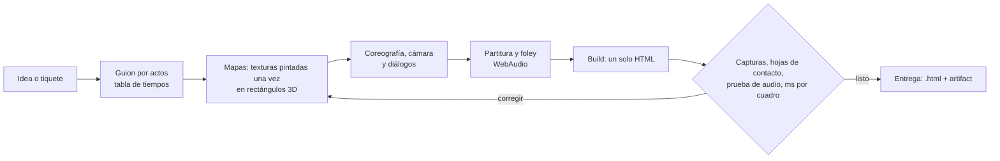

<p align="center">
  
</p>

<h3 align="center">Películas animadas hechas solo con código: dibujo, música y voces.</h3>

<p align="center">
  <a href="#instalar"></a>
  
  
  
  <a href="LICENSE"></a>
</p>

---

**Claude Hollywood** es un skill para Claude que convierte una idea en una película animada de 1 a 10 minutos.

- **Un solo archivo HTML.** Se abre en el navegador y no necesita servidor, librerías ni imágenes externas.
- **Todo sale del código:**
  - los fondos en acuarela o en 3D;
  - los personajes;
  - la luz que entra por una persiana;
  - el polvo en el aire;
  - la tela que cae;
  - la música, los pasos y las voces de 8 bits.
- **Claude trabaja como un estudio:** escribe el guion por actos, diseña los planos y pinta cada textura pieza a pieza. Después compone la banda sonora y revisa su propio trabajo fotograma a fotograma antes de entregarlo.

## ▶ Míralo en acción: *Claude Hollywood 101*

<p align="center">
  <a href="https://htmlpreview.github.io/?https://github.com/Anoth3rHellsing/Claude-Hollywood/blob/main/claude-hollywood-101.html">
    
  </a>
</p>

En este corto de 3:26, **Aguada**, una tacita con boina, explica cómo funciona el skill dentro del propio mundo que el skill dibujó:

1. Congela el invernadero para enseñar su esqueleto 3D.
2. Pinta una acuarela capa a capa.
3. Lanza una piedra en cámara lenta.
4. Toca los cristales como si fueran notas.

**[Ver Claude Hollywood 101](https://htmlpreview.github.io/?https://github.com/Anoth3rHellsing/Claude-Hollywood/blob/main/claude-hollywood-101.html)** (con sonido, en Chrome o Edge). También puedes descargar [`claude-hollywood-101.html`](claude-hollywood-101.html) y abrirlo.

## Instalar

### En Claude Code

```text
/plugin marketplace add Anoth3rHellsing/Claude-Hollywood
/plugin install sumi-e-canvas-film@claude-hollywood
```

En una sola línea (Claude Code 2.1.275 o posterior):

```text
/plugin install sumi-e-canvas-film --marketplace Anoth3rHellsing/Claude-Hollywood
```

Desde la terminal:

```bash
claude plugin marketplace add Anoth3rHellsing/Claude-Hollywood
claude plugin install sumi-e-canvas-film@claude-hollywood
```

### En claude.ai o Claude Desktop

1. Descarga **[`dist/sumi-e-canvas-film.zip`](dist/sumi-e-canvas-film.zip)**.
2. En Claude, abre **Customize → Skills**, pulsa **+ → Create skill → Upload a skill** y elige el zip.
3. Asegúrate de tener activadas la **ejecución de código** y la **creación de archivos**.

## Cómo se usa

Pídele una película como se la pedirías a un estudio:

```text
/sumi-e-canvas-film:sumi-e-canvas-film asistido
Quiero un corto de 4 minutos: una tetera vieja que se pierde en un mercado nocturno de Tokio
y vuelve a casa siguiendo el olor del té. Tono tierno, lluvia, farolillos.
```

Si no lo invocas por su nombre, basta con pedirlo: *«hazme una intro animada en acuarela para mi canal…»*.

| Modo | Cómo trabaja Claude |
|---|---|
| `control` (por defecto) | Te hace una sola ronda de 3–5 preguntas, completa los huecos y te muestra lo que decidió antes de construir. |
| `auto` | Le basta la idea y lo que no se puede tocar. Propone planos, escenas y música por su cuenta. |
| `asistido` | Primero conversan el enfoque, los personajes y el guion por planos. Construye solo cuando dices «dale». |

Al terminar entrega el `.html` y, si estás en claude.ai, lo publica como artifact para verlo y compartirlo.

## Qué sabe hacer

| | |
|---|---|
| 🖌️ **Acuarela y sumi-e** | Tinta que sangra, lavados por capas, bordes húmedos, papel que respira, pincel caligráfico. |
| ✂️ **Papel recortado** | Capas con sombra, ventanas troqueladas con luz detrás, ciudades del día a la noche. |
| 🏠 **Mapas 3D detallados** (motor *Escenarios*) | Ladrillo, madera en espiga, acero cepillado y mármol pintados pieza a pieza. Luz real por persianas, polvo en los haces, tela simulada, agua espejo, vapor, de día y de noche. |
| 👾 **Personajes pixel** | Sombra, reflejo, luz sobre sus píxeles, vecinos generados para llenar las calles. |
| 💬 **Diálogos estilo RPG** | Cajas de texto con retrato y **bleeps de 8 bits** cuya cadencia cambia con el ánimo (prisa, sueño, agotamiento). También rótulos de hora. |
| 🎵 **Sonido procedural** | Temas por personaje, lechos de ambiente, foley (zuecos, campanillas, una llamarada) y mezcla medida en LUFS. Sin muestras ni IA de terceros. |
| 🎬 **Lenguaje de cine** | Guion en actos, cámara con empujes y contrapicados, insertos, cámara lenta, transiciones de tinta o de mosaico pixel. |
| 🔍 **Control de calidad** | Captura cada escena, arma hojas de contacto, prueba todos los sonidos y mide el rendimiento antes de entregar. |

## Hecho con el skill

<p align="center">
  
</p>

| Película | Duración | Qué tiene |
|---|---|---|
| **[Entre el Vapor y el Bit · Crónica de dos Estrellas](https://claude.ai/artifact/X2gP4MZQSCj5p5PDUGTahL)** ([html](entre-el-vapor-y-el-bit.html)) | 7:58 | Un día entero de Teo Cazorla, un cazo de cobre que es chef en un restaurante de dos estrellas: del despertar con prisa a medianoche. Seis mapas 3D, siete personajes, diálogos de 8 bits. |
| **[Claude Hollywood 101](https://htmlpreview.github.io/?https://github.com/Anoth3rHellsing/Claude-Hollywood/blob/main/claude-hollywood-101.html)** ([html](claude-hollywood-101.html)) | 3:26 | La clase de introducción: Aguada explica el skill dentro de un invernadero en otoño. |
| **[Lo-Fi Codes](https://htmlpreview.github.io/?https://github.com/Anoth3rHellsing/Claude-Hollywood/blob/main/lo-fi-codes.html)** ([html](lo-fi-codes.html)) | 3:36 | Fondos animados con música lo-fi sintetizada: invernadero, ciudad, café, auto, mar. |
| «Kurenai», «El Juramento Roto» (3 episodios y tráiler), «El Invernadero de Cristal y Ceniza», «Atlas de ciudades» | 3–10 min | Acuarela, papel recortado, siluetas y magia de tinta. Están en [`Claude-Hollywood/peliculas/`](Claude-Hollywood/peliculas/). |

## Cómo funciona por dentro



- **Todo es función del tiempo:** cada fotograma se calcula a partir de `t`, así que se puede saltar a cualquier segundo (`?t=SEG`) y verificar sin reproducir.
- **Lo plano se pinta una vez y lo que cambia vive:**
  - texturas y sprites se generan en la carga;
  - cada cuadro solo los proyecta, ordenados por profundidad, y les suma la luz.
- **El skill aprende:** cada película deja sus errores y soluciones en [`LECCIONES.md`](Claude-Hollywood/LECCIONES.md), y la siguiente parte de ahí.

## Qué hay en este repositorio

| Ruta | Qué es |
|---|---|
| [`plugins/sumi-e-canvas-film/`](plugins/sumi-e-canvas-film/) | **El skill publicable**: instrucciones, guías, herramientas de prueba y una plantilla que funciona (motor Escenarios + una escena de 20 s). |
| [`.claude-plugin/marketplace.json`](.claude-plugin/marketplace.json) | El marketplace `claude-hollywood` para Claude Code. |
| [`dist/sumi-e-canvas-film.zip`](dist/sumi-e-canvas-film.zip) | El skill listo para subir a claude.ai. |
| [`Claude-Hollywood/`](Claude-Hollywood/) | El estudio completo:<br>• los motores (acuarela, rig 2.5D, fondos, Escenarios);<br>• el código de cada película;<br>• las marcas ficticias y el elenco pixel;<br>• los manuales (`ESCENARIOS.md`, `FONDOS.md`, `RIG.md`) y las lecciones. |
| `*.html` | Las películas terminadas, listas para abrir. |

Para crear algo nuevo con la plantilla sin pasar por Claude:

```bash
cp -r plugins/sumi-e-canvas-film/skills/sumi-e-canvas-film/assets/plantilla mi-pelicula
cd mi-pelicula && python build.py      # → dist/pelicula.html (abre con ?t=5 para el modo prueba)
```

## Aporta lecciones (opcional)

Cada película deja lo que aprendió en [`LECCIONES.md`](Claude-Hollywood/LECCIONES.md), y así la siguiente sale mejor.

- **Si haces algo con el skill**, tu experiencia también puede sumar: un error y su arreglo, o una técnica que funcionó.
- **El propio Claude te lo preguntará una sola vez.** Si aceptas, te enseñará cada lección antes de enviarla, siempre sin datos personales. Si dices que no, no vuelve a preguntar.
- **También puedes aportar a mano** con la plantilla [«Aportar una lección»](https://github.com/Anoth3rHellsing/Claude-Hollywood/issues/new?template=leccion.yml).

Totalmente opcional, y muy agradecido. 🍿

## Licencia

[GPL-3.0](LICENSE) — Copyright (c) 2026 Nicolas Mejia Vargas.  
Este proyecto y la skill `sumi-e-canvas-film` son software libre y código abierto. Puedes usarlo, estudiarlo, modificarlo y crear forks libremente bajo la licencia GNU GPLv3. Queda prohibida su venta directa o cobro comercial por el acceso; debe permanecer libre, gratuito y abierto para toda la comunidad.

Los personajes, las marcas y los mundos de las películas son originales de este proyecto. No es contenido oficial de Anthropic.
