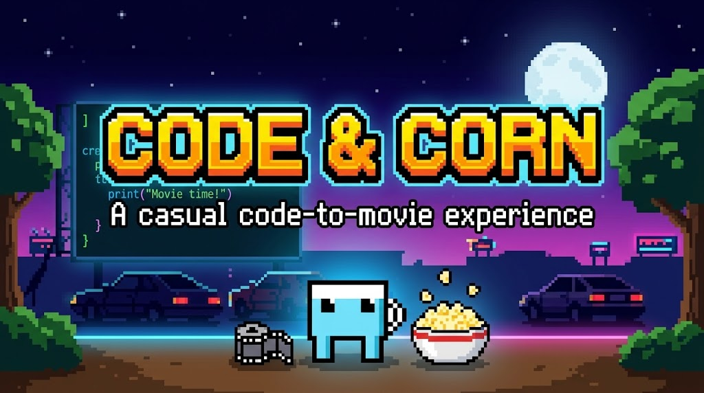
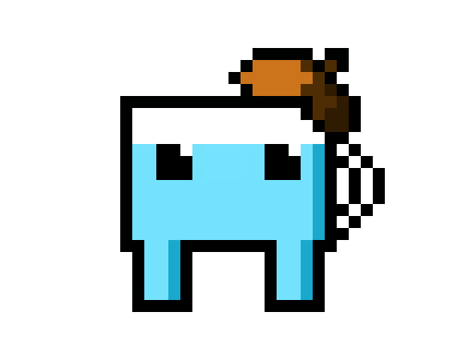

# Code & Corn · Claude Hollywood 101

### Documento de traspaso

Corto de ~3 min donde un personaje 8 bits (la tacita de Nico) explica, en español y con voz de ElevenLabs, cómo funciona la skill `sumi-e-canvas-film`. Este archivo basta para seguir en Claude Code sin el chat original.

## Estado (16 oct 2026)
- **Modo asistido.** Plan discutido y preguntas respondidas. **Falta:** que Nico apruebe el guion (`guion.json`). Después: voz → construcción → revisión.
- **No se ha gastado ningún carácter de ElevenLabs.**

## Archivos de esta carpeta
| Archivo | Qué es |
|---|---|
| `README.md` | Este documento: decisiones, plan, pasos y trampas. |
| `9a5a351c-9b97-482d-a9ee-124c2b61b334.jpg` | Banner de «Code & Corn - A casual code-to-movie experience». |
| `tiquete.json` | Copia del tiquete tal como estaba en la base de datos (doc `tmva5ums2`), con las respuestas de Nico. |
| `guion.json` | Borrador del guion: 18 líneas con bloque, tiempo, texto, caracteres y segundos aproximados. Voz y `voice_id` incluidos. |
| `guion.py` | Script generador de `guion.json` y cálculo de caracteres/tiempos. |
| `sprite_original.png` | El dibujo de Nico (585×450, celdas de 15 px). |
| `sprite_1x.png` | El mismo sprite a 1 px por celda (22×22). |
| `sprite_grid.txt` | El sprite como cuadrícula de letras + paleta, para dibujarlo en canvas sin cargar la imagen. |

## Decisiones tomadas
1. **Protagonista:** la tacita de agua de Nico, con manilla y boina de artista (diseño propio de Nico). No se usa la mascota de Claude Code; tampoco su nombre. Nombre de la tacita: **por decidir** (en el guion habla de sí misma como «una tacita con boina»).
2. **Duración:** ~3 min.
3. **Voz:** Fruna – «Playful, mischievous, sweet», `voice_id = 2CGcaXd1E04jesxY7nfq` (biblioteca de ElevenLabs, español latino, neutra/joven).
4. **Ejemplos:** fotogramas reales de las películas anteriores proyectados en paneles de cristal.
5. Se presenta como una producción de Nico hecha con Claude, **no** como contenido oficial de Anthropic (sin logos ni wordmarks).
6. Lo de siempre: nada de neón (efectos en lenguaje de tinta), violencia nula, de otros artistas solo principios de forma.

## Presupuesto de voz (10.000 caracteres/mes)
- Guion actual: **1.517 caracteres ≈ 1:45 de voz** (a ~14,5 car/s), dentro de 3 min con pausas para las demostraciones.
- Plan: 1.517 + ~500 de retomas ≈ **2.000 de 10.000**.
- **Trampa importante:** `creative_generate_speech` genera **4 variaciones por defecto y cobra las 4**. Pasar siempre `generations_count: 1`. Antes de generar, `estimate_only: true` para ver el costo real (depende del modelo).
- Una llamada **por línea** (L01…L18), todas en el mismo flow (`creative_create_flow` primero). Si una sale mal, se rehace solo esa.
- Nunca repetir una llamada para «reintentar»: cobra otra vez. Para ver el estado, `creative_get_flow_run_status`.
- Modelo: `eleven_v4` admite etiquetas de dirección como `[laughs softly]` o `[whispering]`. Útil en L12 («…Uy.»). Confirmar el precio con `estimate_only`.
- Probar primero **solo L12** (31 caracteres) para comprobar voz, modelo y descarga.

## Plan visual por bloque
Motor: copia de `D:\Claude-Hollywood\invernadero\` (cámara 3D `PJ/PS`, muro de cristal entero/roto FWA/FWB, suelo en franjas, charcos con reflejo, lista de profundidad `put(z,f)`, efectos sin estado). Ver `D:\Claude-Hollywood\skill\SKILL.md` §4 quater, `FONDOS.md` §9 y `LECCIONES.md`.

| Bloque | Líneas | Qué se ve |
|---|---|---|
| B0 0:00 Apertura | L01–L02 | La acuarela se abre (sangrado de tinta) sobre el invernadero de día, en otoño. La tacita aparece con un *blip* 8 bits. |
| B1 0:20 Todo es código | L03–L04 | El mundo se congela y se deshace en su esqueleto: líneas de la cámara 3D, cuadrícula del suelo, costillas. La cámara gira un poco para que se lea 3D y vuelve a pintarse. |
| B2 0:50 La acuarela | L05–L07 | La tacita pinta en un panel: polígono simple → deformación → 20 capas apiladas una a una (cuenta en pantalla) → bordes húmedos. |
| B3 1:20 Lo que ya hicimos | L08–L09 | Tres paneles se iluminan como pantallas con fotogramas reales: Kurenai (samurái bajo la lluvia), El Juramento Roto, el Invernadero de noche. Paneo lento y reflejo en el cristal. |
| B4 1:50 El mundo reacciona | L10–L13 | Demostración de Nico: camina por charcos (ondas y reflejo **pixelado**), agarra una piedra, la lanza, cae un poste oxidado y se viene abajo una sección del muro (reutilizar FWB y las esquirlas del Invernadero). Pausa cómica en L12. |
| B5 2:25 El sonido | L14–L15 | Golpea paneles y cada uno suena como una nota. El viento y la música entran como capas visibles (ondas en las hojas). |
| B6 2:45 Tu turno | L16–L18 | El tiquete aparece como una hoja de papel; tres sellos con los modos (control, auto, asistido). Tarjeta final «Claude Hollywood 101». |

### Mundo de día y en otoño (cambios al motor del Invernadero)
- Luz de sol cálida y rayos diagonales en lugar de la tormenta nocturna. El muro de cristal se repinta con tonos de día.
- Detrás del cristal: **bosque en acuarela amarillo, rojo y naranja** (capa nueva pintada una vez, con paralaje) y **hojas que caen**. Algunas entran por los paneles rotos y se quedan en el suelo y los charcos.
- Hierro oxidado, paneles agrietados, raíces que rompieron el suelo, flores y plantas (ya existen en `22_props` / `24_set`).

### La tacita en el mundo

  

- Sprite **nítido**: `imageSmoothingEnabled = false` y escala entera o redondeada. Solo cambia de tamaño con `PS(z)`; **no** se deforma con la perspectiva.
- El mundo reacciona a ella:
  - sombra cuadrada (en píxeles);
  - ondas en los charcos donde pisa;
  - reflejo pixelado en el agua;
  - hojas que se apartan.
- Animación 8 bits: andar a 2–3 cuadros, salto, «agarrar», lanzar. Parpadeo de ojos. El agua de dentro se mueve un píxel al caminar.
- En `sprite_grid.txt`, la franja blanca de arriba (el vacío del vaso) y el interior de la manilla salen como `.`: son transparentes en el PNG pero en pantalla se ven blancos. Pintarlos blancos o como vidrio claro. `T` = brillo de los ojos.

### Fotogramas reales
Capturarlos con las herramientas de siempre (`shot.py`) de las películas en `D:\Claude-Hollywood` (Kurenai y El Juramento Roto en `motor/` o `cine/`; el Invernadero en `invernadero/dist/`). Unos 2–3 por película, en JPEG de calidad media. Revisar el tamaño total del HTML.

## Sonido
- Todo sintetizado con WebAudio (lechos + eventos, como siempre): ambiente de invernadero de día, viento, hojas, *blips* 8 bits para la tacita, notas en los paneles, crujido del poste, derrumbe de vidrio, música de «clase» curiosa.
- La voz se baja como MP3 y se incrusta en base64 en el HTML.
- **Mide la duración real de cada línea** (decodificando el audio) y saca de ahí los tiempos de los subtítulos y de la animación. No uses los segundos aproximados de `guion.json`.
- Bajar un poco la música (*ducking*) mientras habla.
- Opcional: filtro 8 bits suave (bitcrusher) sobre la voz, solo en el código. Decidir escuchando.
- Subtítulos en español sincronizados, en la capa DOM, con legibilidad de día (variante oscura sobre fondos claros).

## Pasos siguientes
1. Nico aprueba o corrige `guion.json` y decide el nombre de la tacita. Cambiar una línea cambia el conteo: recalcular.
2. ElevenLabs:
   - crear el flow;
   - `estimate_only` de todo;
   - generar L12 como prueba y comprobar que el audio se puede bajar (en el entorno en la nube la descarga puede estar bloqueada; si pasa, bajarlo en el PC de Nico);
   - luego el resto, una línea por llamada con `generations_count: 1`.
3. Construir:
   - copia del motor del Invernadero;
   - mundo de día;
   - sprite y animaciones;
   - planos por bloque;
   - fotogramas;
   - sonido;
   - subtítulos.
4. Revisar con hojas de contacto, recortes a 1920, prueba de Hz reales y audio (SKILL.md §9).
5. Entregar: HTML en esta carpeta y en `D:\Claude-Hollywood\`. Poner el tiquete en «entregado».

## Si sigues en Claude Code
- **La skill** está en `D:\Claude-Hollywood\skill\SKILL.md`. Cópiala a la carpeta de skills de Claude Code (`~/.claude/skills/sumi-e-canvas-film/SKILL.md`) o pídele que la lea al empezar.
- **El tiquete vivo** es un artifact de claude.ai con base de datos. Puede que Claude Code no pueda leerlo; por eso está copiado en `tiquete.json`.
- **ElevenLabs:** el conector de claude.ai no aparece solo en Claude Code. Hay que añadir el servidor MCP de ElevenLabs a Claude Code o darle una API key. Revisar su documentación; aquí no se ha probado.
- **Claude Code en la nube** no ve `C:\` ni `D:\`, solo repositorios de GitHub. Para usar los créditos en la nube, sube esta carpeta y `D:\Claude-Hollywood` a un repo privado. En local (Claude Code en tu PC), sirven tal cual.
- Prompt de arranque sugerido: *«Lee `README.md`, `tiquete.json` y `guion.json` en esta carpeta, y `D:\Claude-Hollywood\skill\SKILL.md`. Seguimos Claude Hollywood 101 en modo asistido desde "Pasos siguientes".»*
